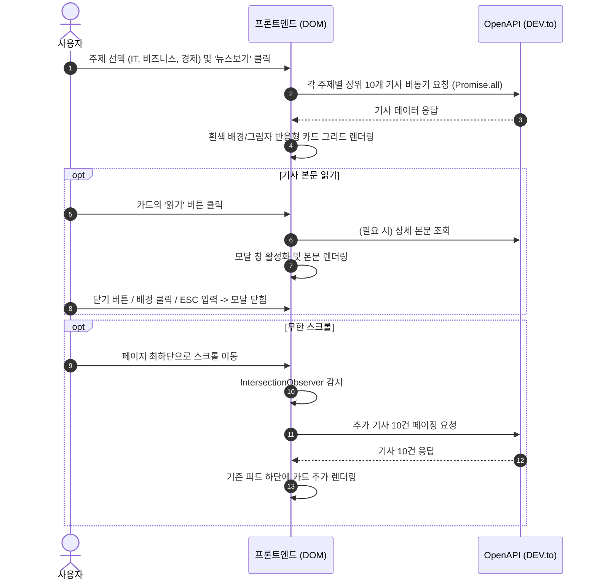

# 맞춤형 뉴스 리더 (Custom News Reader) 개요 및 개발명세서

## 1. 프로젝트 개요 (Overview)

- **프로젝트 명**: 맞춤형 뉴스 리더 (Custom News Reader)
- **개발 목적**: 사용자가 관심 있는 뉴스 주제(IT, 비즈니스, 경제)를 다중 선택하여 최신 헤드라인을 모아보고, 반응형 카드 그리드와 무한 스크롤, 모달 팝업을 통해 기사 본문을 편리하게 열람할 수 있는 웹 애플리케이션 구축
- **핵심 목표**:
  1. **주제 다중 선택**: `IT`, `비즈니스`, `경제` 3개 주제의 다중 선택 지원 및 '뉴스보기' 실행 버튼 제공
  2. **OpenAPI 헤드라인 수집**: 선택된 각 주제별 상위 10개 최신 헤드라인을 무료 OpenAPI에서 가져와 피드에 표시
  3. **카드 UI 및 본문 모달**: 제목, 이미지, '읽기' 버튼이 있는 카드 형태 렌더링 및 클릭 시 모달로 본문 표시
  4. **무한 스크롤(Infinite Scroll)**: 페이지 최하단 도달 시 추가 기사 10건 자동 로드
  5. **반응형 디자인**: 흰색 배경과 부드러운 그림자가 적용된 카드와 반응형 그리드 레이아웃 구축
  6. **요구사항 준수**: 명시된 기능 이외의 불필요한 기능(북마크, 다크모드, 검색창 등) 배제

---

## 2. 기술 스택 및 개발 환경 (Tech Stack)

| 구분 | 기술 / 라이브러리 | 설명 |
| :--- | :--- | :--- |
| **마크업** | HTML5 | 시맨틱 웹 표준 구조 (`header`, `main`, `section`, `article` 등) |
| **스타일링** | Vanilla CSS3 | CSS Grid, Flexbox, Box-shadow, 반응형 미디어 쿼리 |
| **스크립트** | Vanilla JavaScript (ES6+) | Fetch API, `IntersectionObserver` API, DOM 조작 |
| **데이터 API** | 무료 REST OpenAPI | DEV.to 공개 Articles API (별도 인증키 불필요, CORS 허용) |

---

## 3. UI/UX 레이아웃 구조

```text
┌────────────────────────────────────────────────────────────────────────┐
│ [헤더 영역]                                                             │
│ 맞춤형 뉴스 리더         [☑ IT]  [☑ 비즈니스]  [☑ 경제]   [뉴스보기 버튼]  │
├────────────────────────────────────────────────────────────────────────┤
│ [뉴스 피드 - 반응형 그리드 (CSS Grid)]                                   │
│ ┌───────────────────┐  ┌───────────────────┐  ┌───────────────────┐    │
│ │ [기사 썸네일]     │  │ [기사 썸네일]     │  │ [기사 썸네일]     │    │
│ │ [주제 배지]       │  │ [주제 배지]       │  │ [주제 배지]       │    │
│ │ 기사 제목         │  │ 기사 제목         │  │ 기사 제목         │    │
│ │ [읽기 버튼]       │  │ [읽기 버튼]       │  │ [읽기 버튼]       │    │
│ └───────────────────┘  └───────────────────┘  └───────────────────┘    │
├────────────────────────────────────────────────────────────────────────┤
│ [무한 스크롤 감지 영역 (Sentinel)] - 하단 스크롤 시 기사 10건 추가 로드  │
└────────────────────────────────────────────────────────────────────────┘

[기사 본문 모달 (읽기 버튼 클릭 시 오버레이 팝업)]
┌─────────────────────────────────────────────────────────┐
│ [주제 배지]                                    [닫기(X)]│
│ 기사 제목 (Heading)                                     │
│ [기사 대표 이미지]                                       │
│ 기사 본문 내용 (스크롤 가능)                             │
└─────────────────────────────────────────────────────────┘
```

---

## 4. 상세 기능 개발명세서 (Functional Specification)

### 4.1. 주제 다중 선택 및 뉴스보기
- **UI 요소**:
  - 다중 체크박스: `IT`, `비즈니스`, `경제`
  - 실행 버튼: `'뉴스보기'` (`#view-news-btn`)
- **동작 규칙**:
  1. 사용자가 원하는 주제를 1개 이상 선택 후 '뉴스보기' 버튼을 클릭합니다.
  2. 선택된 주제가 없는 경우 `"주제를 하나 이상 선택해주세요."` 경고 메시지를 노출하고 조회를 중단합니다.
  3. 조회가 시작되면 기존 피드를 초기화하고 로딩 인디케이터를 표시합니다.

### 4.2. OpenAPI 연동 및 기사 수집
- **엔드포인트**: `https://dev.to/api/articles?tag={tag}&page={page}&per_page={perPage}`
- **주제별 태그 매핑**:
  - `IT` $\rightarrow$ `tag: technology`
  - `비즈니스` $\rightarrow$ `tag: business`
  - `경제` $\rightarrow$ `tag: economy`
- **수집 데이터 정규화**:
  - `id`: 기사 고유 식별자
  - `topic`: 기사 카테고리 (IT / 비즈니스 / 경제)
  - `title`: 기사 제목
  - `image`: 기사 커버 이미지 URL (누락 시 카테고리별 대체 고해상도 이미지 적용)
  - `description` / `bodyHtml`: 기사 요약 및 상세 본문 내용

### 4.3. 카드 UI 및 본문 모달
- **카드 디자인 규격**:
  - 배경: 깔끔한 흰색 (`background-color: #ffffff;`)
  - 그림자: 입체감 있는 부드러운 그림자 (`box-shadow: 0 4px 16px rgba(0, 0, 0, 0.08);`)
  - 호버 효과: 살짝 떠오르는 모션 (`translateY(-5px)`, `box-shadow: 0 12px 28px rgba(0, 0, 0, 0.12);`)
  - 구성: 썸네일 이미지, 카테고리 배지, 제목, '읽기' 버튼
- **모달 기능**:
  - 카드의 `'읽기'` 버튼 클릭 시 해당 기사의 상세 본문을 불러와 모달 창 활성화
  - 배경 스크롤 방지 (`overflow: hidden`)
  - 모달 닫기 지원: 우측 상단 닫기(X) 버튼, 백드롭(배경) 클릭, `ESC` 키 입력

### 4.4. 무한 스크롤 (Infinite Scroll)
- **구현 메커니즘**: `IntersectionObserver` API를 활용하여 피드 하단의 센티넬(`#scroll-sentinel`) 감지
- **동작 규칙**:
  1. 사용자가 페이지 하단까지 스크롤 시 감지기가 트리거됩니다.
  2. 현재 선택된 활성 주제에 맞추어 **정확히 기사 10건**을 다음 페이지에서 호출합니다.
  3. 중복 호출 방지 플래그(`isFetching`) 및 로딩 인디케이터를 통해 부드러운 데이터 로드를 보장합니다.

### 4.5. 반응형 그리드 레이아웃
- **그리드 정의**: `display: grid; grid-template-columns: repeat(auto-fill, minmax(320px, 1fr)); gap: 28px;`
- **반응형 브레이크포인트**:
  - 모바일 (< 768px): 1열 전체 폭 레이아웃
  - 태블릿 (768px ~ 1024px): 2열 그리드 레이아웃
  - 데스크톱 (> 1024px): 3~4열 그리드 레이아웃

---

## 5. 데이터 흐름 및 시퀀스



---

## 6. 파일 구성 및 실행 방법

### 파일 구조
```text
project09/
├── index.html        # 메인 웹페이지 구조 및 모달 마크업
├── style.css         # 반응형 그리드, 카드 섀도우, 모달 스타일
├── app.js            # OpenAPI 비동기 통신, 이벤트 처리, 무한 스크롤 로직
└── SPECIFICATION.md  # 개요 및 개발명세서 문서
```

### 실행 방법
1. 로컬 웹 서버 실행 (Python 내장 서버 기준):
   ```bash
   python3 -m http.server 8089
   ```
2. 웹 브라우저에서 `http://localhost:8089` 접속 또는 `index.html` 파일을 직접 열어 사용.
